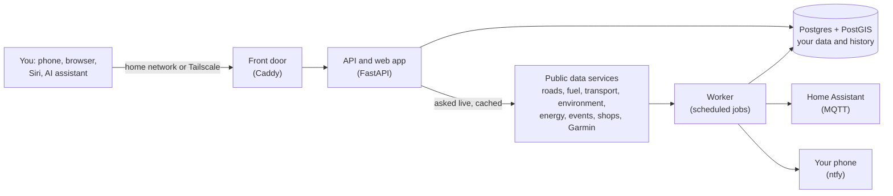

# World Assistant

[](https://github.com/rpearson-dot/World-assistant/actions/workflows/ci.yml)

**The other half of a smart home.** Home Assistant knows what is happening inside the house. World Assistant knows
what is happening outside it: the roads, buses and trains, fuel and energy prices, floods, air and pollen, what is
on nearby, the shopping, and the bikes and cars in the garage.

It runs on your own server, keeps its own history, and answers in one place: a web app on your phone, Home
Assistant sensors, Siri Shortcuts, an AI assistant, or a script.

## Why it exists

What happens outside the house is spread across dozens of public services. Each has its own key, limits, format and
quirks, and almost none keeps a history, so you can never ask *"is this normal?"*.

World Assistant sits in the middle:

- **It asks each service once, politely.** It keeps to every provider's limits, so ten questions do not mean ten calls.
- **It keeps what is worth keeping.** Road events, fuel prices, bus timings, pollen and bike rides are stored, so you
  get trends ("how often is the 7:42 late?"), not only "right now".
- **It answers about your places and journeys, not the whole country.** Is the M25 clear towards Brighton? Where is
  the cheapest E10 on the way? Is the river near home high? What is on this Saturday? Is the Reiver ready to ride?
- **It stays yours.** No account, no cloud service, no telemetry. Your places, trips and vehicles never leave your
  server. The only calls out are to the public data services.

It is **UK-focused**, since most of its sources are British. It started on a home Unraid server, but nothing in it
needs Unraid.

## What it does

The web app (installable on a phone) has a page for each area. Everything is also available to Home Assistant,
the assistant and the API.

**Getting about**
- **Buses:** live bus tracking with on-time statistics, and live bus positions across Great Britain ([bus](docs/bus.md), [live buses](docs/live-buses.md)).
- **Trains:** departure boards from TfL and National Rail, and TfL station status, including closed lifts ([trains](docs/trains.md), [stations](docs/stations.md)).
- **Roads:** National Highways closures, speed limits and message signs, and TfL road works, with history. Each is tagged with the routes you use ([trip conditions](docs/trip-conditions.md), [TfL roads](docs/tfl-roads.md)).
- **Fuel and charging:** every UK forecourt's prices, cheapest near you or along a route, and GRIDSERVE chargers that are free now ([EV](docs/ev.md)).
- **Places, trips and the map:** your places and routes, everything with a position on one map, and **Here**: what is around you right now ([map](docs/map.md), [here](docs/here.md)).

**Home and surroundings**
- **Energy:** your Octopus tariff's cheap and peak times, and Saving Sessions, for Home Assistant to run the battery from ([energy](docs/energy.md)).
- **Environment:** air quality, pollen, flood warnings, river levels and flows compared with normal, tides and storm overflows ([environment](docs/environment.md), [floods](docs/floods.md)).
- **Power:** UK Power Networks cuts and works near your places ([power](docs/power.md)).
- **Events:** what is on nearby from Skiddle, Ticketmaster and Data Thistle. You can mute events or words you never want to see.
- **Safety:** crime near a place compared with the neighbouring boroughs, and your local police team.

**Shopping**
- **Shopping list:** the family's KitchenOwl list priced at Sainsbury's and Ocado, ready to send to either basket. Nothing is ever ordered or paid for ([shopping](docs/shopping.md)).
- **Wishlist and outdoors:** Aldi and Lidl special buys, and outdoor gear prices at GO Outdoors and Decathlon ([wishlist](docs/wishlist.md), [outdoors](docs/outdoors.md)).
- **Food alerts:** allergy alerts and recalls checked against your shopping, and hygiene ratings nearby.

**Vehicles and bikes**
- **Vehicles:** cars and vans with tax and MOT from DVLA and DVSA, trip costs, range, and the [Leaf dashboard](docs/leaf.md).
- **Bikes:** rides from Garmin, wear on every part, service lists, spares, and a battery summary for each bike, all in a game-style Garage ([bikes](docs/bikes.md)).

**Telling you and answering you**
- **Home Assistant:** sensors appear by themselves over MQTT, with ready-made dashboards ([Home Assistant](docs/home-assistant.md)).
- **Notifications:** alerts on your phone through World Assistant's own ntfy server: low batteries, parts due, flood warnings ([notifications](docs/notifications.md)).
- **Assistant:** spoken-style answers for Siri Shortcuts (`/v1/ask`) and AI assistants over MCP (`/mcp`) ([assistant](docs/assistant.md)).
- **Knowledge graph:** an optional graph of how it all joins up, to explore on the Graph page ([graph](docs/graph.md)).

## How it fits together



A **worker** collects the feeds worth storing, on a schedule, and writes them to Postgres. The **API** answers from
the database, so a question never waits on a slow or rate-limited service, and still works when one is down.
Things that are only useful live (train boards, events) are asked for when needed and cached briefly. Every
request comes through a small **front door**, so an update can start the new version beside the old one and switch
over with no gap.

More: [architecture](docs/architecture.md).

## Getting started

You need a server with Docker and Compose. API keys are free and each is optional: a feature without its key says
it is not set up. Home Assistant is optional too.

```bash
git clone https://github.com/rpearson-dot/World-assistant.git && cd World-assistant
bash scripts/setup.sh
```

`setup.sh` asks where to keep the data, whether you use Home Assistant, and for each key (what it unlocks and where
to get it). It then starts everything and prints the address. Run it again any time to change an answer.

Then open `http://<server>:8010`. No token is needed on your home network. **Settings** has a short setup wizard
and a list of what is working. Add your home on **Places** first, since it is the default place everywhere.

**Away from home:** never open the port to the internet. Add the Tailscale container instead (`setup.sh` asks). It
gives World Assistant its own `https://world-assistant.<tailnet>.ts.net` address for your phone, Siri and AI
assistants ([Tailscale](docs/tailscale.md)).

Is it for you? It suits you if you run a home server, live in the UK, and like owning your data. It is a personal
project, not a hosted service, not a navigation or safety system, and not affiliated with any data provider. Do
not rely on it where a wrong or late answer could hurt anyone.

## Keeping it up to date

- **Updates have no gap.** The new version starts beside the running one and is checked. It is then tried on one
  request in five, and takes over while the old one stands by. If anything fails, the old one carries on as if
  nothing happened.
- **Update now, or every night.** Settings → Backups and updates has an **Update now** button and an **Update
  this server automatically** box (04:00). The updater container does the work. It installs only releases signed
  by this repository's release workflow, and takes a backup first.
- **By hand:** `bash scripts/deploy.sh`.

Details: [runbook](docs/runbook.md).

## Security in brief

- **Tokens:** from outside the home network every request needs a token. At home, and in a browser on your
  tailnet, the web app needs none ([what counts as home](docs/security.md#access)).
- **Secrets:** kept as files or in an optional key vault, never in the code or environment.
- **Containers:** the app runs as a non-root user, and there is an optional read-only, hardened profile.
- **Supply chain:** dependencies are pinned by hash, releases are signed with SBOMs, and every change is scanned.

More: [security](docs/security.md) and [SECURITY.md](SECURITY.md).

## Documentation

Start with the [documentation index](docs/README.md). The most used pages are:

- [Architecture](docs/architecture.md): how it is built, with diagrams
- [Runbook](docs/runbook.md): install, update, back up, troubleshoot
- [API reference](docs/api.md): every endpoint (and the live reference at `/docs` on your server)
- [Data sources](docs/data-sources.md): each feed, its key, limits, licence and credit
- [Changelog](CHANGELOG.md): what changed in each release

## Data and credits

The data comes from National Highways, GOV.UK Fuel Finder, Transport for London, National Rail, the Bus Open Data
Service, NaPTAN, the Environment Agency, Defra, the National River Flow Archive, Ordnance Survey, what3words,
data.police.uk, the ONS, the Food Standards Agency, UK Power Networks, Octopus Energy, GRIDSERVE, DVLA, DVSA,
Skiddle, Ticketmaster, Data Thistle, the Austrian Pollen Information Service, Garmin, and OpenStreetMap
contributors. Each stays under its own licence and terms ([data sources](docs/data-sources.md)). Raw feed data is
never committed to this repository.

## Development

```bash
pip install --require-hashes --no-deps -r requirements-dev.lock
ruff check . && pytest
```

Tests that need Postgres or Redis are skipped unless `WA_TEST_DATABASE_URL` and `WA_TEST_REDIS_URL` are set. CI
also runs the whole stack, requests every page and endpoint, and updates the previous release to the new code in
stages with requests running. See [CONTRIBUTING.md](CONTRIBUTING.md).

## Licence

[MIT](LICENSE). No warranty. Third-party data stays under its own licence.
