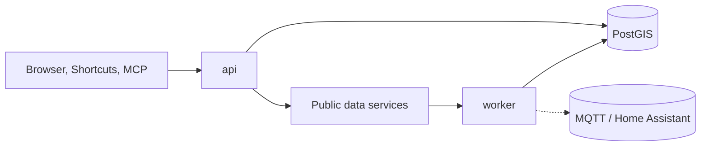

# World Assistant

[](https://github.com/rpearson-dot/World-assistant/actions/workflows/ci.yml)

**The other half of a smart home.** Home Assistant knows what is going on inside the house. World
Assistant knows what is going on outside it: the roads you drive, the fuel you buy, the buses and
trains you catch, what is on nearby, and what the pollen is doing to your hay fever. It runs on your
own server, keeps its own history, and answers in one place, whether you ask from a web page, a Siri
Shortcut, a script, an AI assistant, or a sensor on your Home Assistant dashboard.

## Why it exists

Everything outside the house that affects your day is scattered. Road closures are in one government
feed, fuel prices in another, bus and train times in two more, events on commercial sites, pollen on a
European service. Each has its own key, rate limit, format and quirks, and almost none keep a history,
so you can never ask *"is this normal?"*.

World Assistant is a small, self-hosted gateway that:

- **talks to each source once, politely.** It respects every provider's limits, so ten questions
  do not mean ten calls;
- **keeps what is worth keeping.** Road events, fuel price changes, bus timings and pollen are stored, so
  you get trends and "how often is the 7:42 late?", not only "right now";
- **answers questions about *your* journeys and places, not the whole country.** *What is the M25 like
  towards Brighton right now? Where is the cheapest E10 along the way, and is it worth the detour? What will
  the trip cost in the petrol car versus the electric one? Did my bus make the stop before the deadline this
  week? What is on near home on Saturday? How bad is the birch pollen tomorrow?*
- **stays yours.** Your places, trips and vehicles never leave your server. There is no account, no cloud
  service and no telemetry; the only outbound calls are to the public data services.

It started as a personal project on a home Unraid server. Nothing in it is specific to Unraid, but it is
**UK-focused**: most of the data sources are British.

## What it does

| Area | What you get |
|------|--------------|
| **Roads** | National Highways closures, variable speed limits and message signs, polled and stored with history. Each event is tagged with the corridors (your regular routes) it affects. |
| **Fuel** | Every UK station's current prices from the government Fuel Finder service, refreshed every 30 minutes. Cheapest near a place or along a route, with the saving after the detour. |
| **Events** | What is on near a place (gigs, comedy, theatre, sport and more) from Skiddle and Ticketmaster, merged by date. |
| **Pollen** | Pollen by allergen and allergy risk for today and three days ahead, with a 90-day history and graphs. |
| **Places and trips** | Named places (by postcode or coordinates) and trips between them. Your **home** is the default place everywhere. |
| **Routing** | Optional self-hosted Valhalla turns a trip into a real road line, which becomes that trip's corridor. |
| **Vehicles** | Petrol/diesel (mpg) and electric (battery, health, miles per kWh). Trip cost, range check, and whether a cheaper station is worth the detour. |
| **Buses and trains** | Live bus tracking with on-time statistics, and train departure boards (TfL and National Rail). Departures, fuel prices and road closures are published to Home Assistant over MQTT, and fuel, roads, pollen (a map and a home graph) follow where each person is, and events show what is on near the home zone and any extra places you add (the app's location when away, else the home zone) ([how](docs/home-assistant.md)), with ready-made dashboards. |
| **Assistant** | The same data as spoken-style answers: `/v1/ask` for Siri Shortcuts and scripts, and `/mcp` for AI assistants that speak the Model Context Protocol. |
| **Web pages** | `/status`, `/bus`, `/trains`, `/fuel`, `/events`, `/pollen`, `/places`. Small, fast, no accounts. |
| **Operations** | One-click backups, signed releases, optional automatic updates with rollback, optional bundled key vault. |

Planned (see [docs/roadmap.md](docs/roadmap.md)): live-traffic journey times, MOT and tax reminders,
efficiency trends.

## How it works



A **worker** polls the feeds that are worth storing on a slow schedule and writes them to Postgres. An
**API** answers from the database, so a question never waits on a rate-limited upstream and keeps working
when one is down. Live services that are not stored (events, train boards) are cached briefly. It all runs
as a small Docker Compose stack: FastAPI, an arq worker, PostGIS Postgres and a private, password-protected
Redis, plus optional Valhalla and OpenBao. Details: [docs/architecture.md](docs/architecture.md).

## Is it for you?

It suits you if you run a home server, live in the UK, and like owning your data and your automations.
You will need to register for a few free API keys (see [docs/data-sources.md](docs/data-sources.md)); each
is optional, and a feature without its key simply says it is not set up.

It is **not** a hosted service, not a navigation or safety system, and not affiliated with any data
provider. Do not rely on it for anything where a wrong or late answer could hurt anyone. It is a
personal project: use it, fork it, send fixes, but expect no support level.

## Quick start

You need Docker with Compose, an MQTT broker you can reach (only for Home Assistant sensors; the
stack insists on an address, a placeholder is fine if you do not use it), and the keys you want.

```bash
git clone https://github.com/rpearson-dot/World-assistant.git && cd World-assistant
cp .env.example .env              # set the MQTT address and where your data and secrets live
bash scripts/init-secrets.sh      # creates the secret files, generates the passwords
# put your API keys in the secret files it lists, then:
docker compose up -d --build
curl http://localhost:8010/readyz
```

Open `http://<host>:8010/status`, paste the token from the `api_token` secret file, and press Load. Add
your places (start with `home`) and trips on `/places`.

For routing, add the Valhalla container (downloads a ~2 GB map on first start):

```bash
docker compose -f docker-compose.yml -f docker-compose.routing.yml up -d
```

Do not expose the port to the internet. Reach it over a private network such as Tailscale
([docs/assistant.md](docs/assistant.md#reaching-it-from-outside-the-house)).

## Staying up to date

- **By hand:** `bash scripts/sync.sh --deploy` (a git checkout) or `bash scripts/deploy.sh` (a copy).
  Both back up first and finish with a check that every page and endpoint still answers.
- **Released images:** releases are built once by GitHub Actions, scanned, signed and published with SBOMs,
  and deployed by digest, never by tag.
- **Automatically (optional, off by default):** a switch on `/status` makes a nightly job install the newest
  signed release, with a backup first and an automatic rollback if the post-update check fails. On GitHub,
  Dependabot checks daily and can merge safe updates once CI is green.

All of it is in [docs/runbook.md](docs/runbook.md).

## Security in brief

Every `/v1/*` route needs a bearer token and refuses everything if none is set. Secrets are files (or an
optional key vault), never environment variables or committed. The image runs as a non-root user and an
optional hardened profile makes it read-only. Dependencies are pinned by hash, actions by commit,
releases are signed (Sigstore) with SBOMs, and every push is scanned for secrets. See
[docs/security.md](docs/security.md) and [SECURITY.md](SECURITY.md).

## Documentation

- [Architecture](docs/architecture.md): components, data flow, schema
- [Runbook](docs/runbook.md): deploy, upgrade, roll back, automatic updates, troubleshoot
- [Data sources](docs/data-sources.md): each feed, its limits, licence and credit
- [Assistant](docs/assistant.md): Siri Shortcuts, MCP, the default place
- [Bus tracker](docs/bus.md), [Trains](docs/trains.md)
- [Backups](docs/backup.md): the status-page button, the deploy script and restoring
- [Secrets and key vaults](docs/secrets.md), [bundled OpenBao](docs/openbao.md)
- [Security](docs/security.md): what is protected and how; supply chain
- [GitHub settings](docs/repo-settings.md): branch protection and the other repository settings
- [Roadmap](docs/roadmap.md) and [decisions](docs/adr/): what is parked, and why it is built this way
- [Changelog](CHANGELOG.md), [Contributing](CONTRIBUTING.md), [Security policy](SECURITY.md)

## API at a glance

All `/v1/*` routes need `Authorization: Bearer <api_token>`. The interactive reference is at `/docs`.

| Route | Purpose |
|-------|---------|
| `GET /v1/status` | Job runs, event counts, corridors, fuel counts, version, worker heartbeat |
| `GET/PUT/DELETE /v1/places/{id}`, `/v1/trips/{id}`, `/v1/vehicles/{id}` | Manage places, trips, vehicles |
| `POST /v1/trips/{id}/route` | Route a trip and (re)build its corridor |
| `GET /v1/trips/{id}/cost?vehicle=` | Energy or fuel needed, range check, cost |
| `GET /v1/fuel/near`, `/v1/fuel/along/{corridor}` | Cheapest fuel near a place or along a corridor; `vehicle=` ranks by saving after the detour |
| `GET /v1/events/near` | What is on near a place (`place` defaults to home) or a point (`lat` and `lon`) |
| `GET/POST /v1/ha/locations`, `GET /v1/ha/locations/events` | Extra places Home Assistant watches for events (capped, they expire) |
| `GET/POST /v1/ha/routes`, `POST /v1/ha/routes/delete` | Routes Home Assistant adds between two positions (both ways, routed locally, capped); their corridors become roads sensors |
| `POST /v1/bus/settings` | Change a bus tracker's deadline, earliest time and the time to stop showing the chance, without resetting it |
| `GET /v1/pollen/near`, `/v1/pollen/grid`, `/v1/pollen/history` | Pollen forecast (a place, defaulting to home, or a point with `lat` and `lon`) and the recorded history |
| `GET /v1/tfl/boards`, `/v1/bus/trackers/{id}/…` | Train departure boards and the bus tracker |
| `POST /v1/ask/{tool}`, `POST /mcp` | Spoken-style answers for Shortcuts, scripts and MCP clients |
| `GET/POST /v1/backups` | List, create and download backups |

## Data sources and credits

Road data from National Highways, fuel prices from GOV.UK Fuel Finder, bus and rail from Transport for
London and National Rail (Rail Data Marketplace), events from Skiddle and Ticketmaster, postcodes from
postcodes.io, maps © OpenStreetMap contributors, and pollen from the Austrian Pollen Information Service
(www.polleninformation.at, non-commercial use only). Each stays under its own licence and terms; see
[docs/data-sources.md](docs/data-sources.md). Raw feed data is never committed to this repository.

## Development

```bash
pip install --require-hashes --no-deps -r requirements-dev.lock
ruff check . && pytest
```

Tests that need Postgres or Redis are skipped unless `WA_TEST_DATABASE_URL` / `WA_TEST_REDIS_URL` are set.
CI also starts the whole stack and requests every page and endpoint. See [CONTRIBUTING.md](CONTRIBUTING.md).

## Licence

[MIT](LICENSE). No warranty. Third-party data stays under its own licence.
