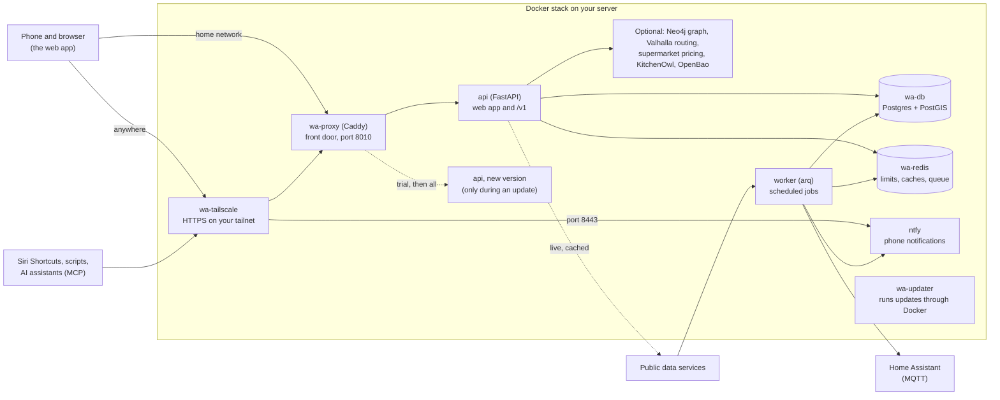
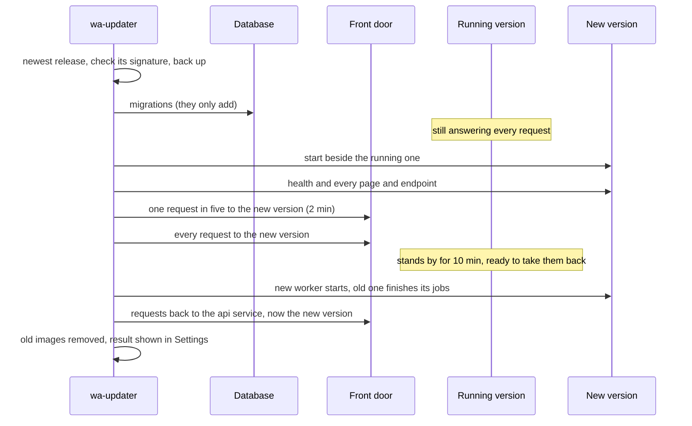

# Architecture

World Assistant is a small Docker Compose stack on one server. A **worker** collects the outside world on a
schedule and keeps it in **Postgres**. An **API** answers from Postgres, and serves the web app. A **front door**
takes every request, so the API can be swapped for a new version without a gap. Everything else is optional and
added with a compose file.

## The stack



| Container | What it does |
|---|---|
| `wa-proxy` | The front door (Caddy) and the only published port (8010). Tailscale and Traefik point at it too. It passes each request to the api and says who connected (`X-WA-Peer`), which the api believes only from this container. During an update it moves requests to the new version ([staged updates](runbook.md#staged-updates-no-gap)). |
| `api` | FastAPI. Serves the web pages and `/v1/*`, the assistant (`/v1/ask`, `/mcp`), settings, backups and updates. Answers from the database; asks a few live services (train boards, events, Here) when needed, with short caches. |
| `worker` | arq. Runs every scheduled job: polls the feeds that are stored, syncs Garmin rides, publishes Home Assistant sensors, sends notifications. The only writer of feed data. Records a heartbeat shown in Settings. |
| `migrate` | One-shot Alembic job before the api and worker start. Migrations only add ([migrations](migrations.md)). |
| `wa-db` | PostGIS Postgres, private to the stack. Anything with a position has an indexed geography column ([ADR 0007](adr/0007-postgis.md)). |
| `wa-redis` | Private, password protected, nothing saved to disk: the shared rate limiter, short caches, the job queue and heartbeat. Keys start `wa:`. |
| `wa-updater` | Runs updates: nightly when automatic updates are on, and within a minute of Update now. It drives Docker through the server's socket, publishes no port, and installs only signed releases ([runbook](runbook.md#the-updater-container)). |
| `wa-tailscale`, `ntfy` | Optional (`docker-compose.tailscale.yml`). World Assistant as its own device on your tailnet with HTTPS, and the ntfy server for phone notifications on port 8443 of the same device ([Tailscale](tailscale.md), [notifications](notifications.md)). |
| `wa-mqtt` | Optional broker, if Home Assistant has none ([Home Assistant](home-assistant.md)). |
| `wa-graph` | Optional Neo4j, rebuilt from Postgres, so it owns no data and is left out of backups ([graph](graph.md)). |
| `valhalla` | Optional routing engine: turns a trip into a road line ([ADR 0005](adr/0005-routing-engine.md)). |
| `kitchenowl`, `wa-supermarket` | Optional: the family shopping list (on its own tailnet address), and pricing at Sainsbury's and Ocado ([shopping](shopping.md)). |
| `openbao` | Optional key vault for the secrets ([OpenBao](openbao.md)). |

## Where the data comes from

```mermaid
flowchart LR
  subgraph stored["Collected on a schedule and kept (worker)"]
    roads["Roads: National Highways,<br/>TfL road works"]
    fuel["Fuel and charging:<br/>Fuel Finder, GRIDSERVE"]
    transport["Transport: TfL, National Rail,<br/>bus tracker, NaPTAN, BODS"]
    env["Environment: floods, rivers,<br/>air, pollen, tides, overflows"]
    home["Home: Octopus, UK Power Networks"]
    garage["Garage: Garmin rides,<br/>DVLA and DVSA, recalls"]
    shops["Shops: KitchenOwl, Aldi, Lidl,<br/>GO Outdoors, Decathlon, FSA alerts"]
    ref["Reference: postcodes, boundaries,<br/>streets, bank holidays"]
  end
  subgraph live["Asked when needed, cached briefly (api)"]
    boards["Train boards"]
    events["Events: Skiddle,<br/>Ticketmaster, Data Thistle"]
    crime["Crime and police,<br/>borough populations"]
    misc["what3words, postcodes.io,<br/>food hygiene"]
  end
  stored --> pg[("Postgres")]
  pg --> answers["Pages, API, assistant,<br/>Home Assistant, notifications"]
  live --> answers
```



Each source, with its key, limits and licence: [data sources](data-sources.md).

## How a request is answered

1. **In.** A request reaches the front door: from the home network on port 8010, or from anywhere through
   Tailscale's HTTPS address.
2. **Who is asking.** The api decides whether a token is needed from who connected: no token on the home network
   or for the web app on your tailnet, a token for everything else ([security](security.md#access)).
3. **Answer.** Endpoints read from Postgres, so a question never waits on a rate-limited service and still works
   when one is down. The few live services are cached for seconds to hours, and say so when unavailable.
4. **Pages.** A web page holds no data. It is a static page whose script calls the same `/v1` endpoints anyone
   can ([API reference](api.md)).

## How the data is kept

1. **Poll politely.** The worker fetches a feed through the shared rate limiter, normalises it, and upserts.
2. **Replace only on complete data.** A fetch that failed part-way never clears what is stored. Road events
   missing from a complete fetch are marked cleared, not deleted; fuel prices are applied only when the fetch
   covers at least 90% of stations ([ADR 0002](adr/0002-polling-and-completeness.md)).
3. **Tag.** Road events are matched to your routes (corridors) by road number and distance
   ([ADR 0003](adr/0003-corridor-matching.md)). Things with a position are queried by distance with PostGIS.
4. **Keep the history.** Price changes, sign messages, bus timings, pollen, rides and services are kept, so
   trends can be shown.

## How an update runs



If the new version fails any check before the last step, the front door sends everything back to the running
version, which has answered throughout. The update reports "rolled back" and nothing needs restoring. Releases are
built once by CI, signed and deployed by digest ([ADR 0004](adr/0004-immutable-releases.md)).

## Code layout

The core is `app/`; every module (an area such as fuel, buses or the bike garage) is a folder of its own under
`app/modules/`, with its API, pages, jobs, assistant tools and the outside services it reads. The core never imports
a module: modules plug in at declared extension points, and a test holds both sides to the
[module SDK](module-sdk.md).

```
app/
  main.py, worker.py, config.py              the api, the worker and settings
  auth.py, localnet.py                       who needs a token
  places.py, geo.py, geoquery.py, corridor.py   places, postcodes, distance queries, route corridors
  pagestyle.py, themes.py, look.py, whereami.py the page shell, menu, themes, the place picker
  assistant.py, assistant_base.py            /v1/ask and /mcp: the core's tools, and the tools' building blocks
  ha*.py, mqtt*.py                           Home Assistant: publishing, setup, locations and routes
  notify.py, notify_jobs.py                  phone notifications through ntfy
  map_layers.py, map_page.py                 the map, and its core layers
  backup*.py, autodeploy.py, status.py       backups, updates, status
  jobs.py, ratelimit.py                      job records and the shared rate limiter
  modules/                                   the registry (model, registry, sdk, builtin declarations) and:
    <id>/                                    one folder per module: README.md, API, pages, tools.py, notify.py,
      sources/<name>/                        and each outside service: client, normalise, store, sync, probe
migrations/versions/                         Alembic revisions
deploy/                                      the front door, updater image, Tailscale and Unraid files
scripts/                                     setup, deploy, staged rollout, updates, backups, CI checks
services/supermarket/                        the supermarket pricing service
```

Each outside service has the same shape: a **client** (HTTP, auth, paging, retries, rate limit), a **normalise**
module (pure functions from raw JSON to dataclasses), usually a **store** (SQL), and jobs for the worker. The
parsers are pure so they can be tested against small fixtures. Most have a **probe** that shows the real response:
`python -m app.modules.<id>.sources.<name>.probe`.

## The database

| Area | Tables |
|---|---|
| Your data | `place`, `trip`, `vehicle`, `ha_location` |
| Roads | `nh_event`, `nh_event_corridor`, `nh_sign`, `nh_sign_message`, `nh_corridor`, `tfl_road_disruption` |
| Fuel and charging | `fuel_station`, `fuel_price`, `fuel_price_change`, `ev_site`, `ev_evse`, `ev_tariff`, `ev_site_log` |
| Buses and trains | `bus_tracker`, `bus_stop`, `bus_segment_obs`, `bus_anomaly`, `bus_target_day`, `bus_target_hit`, `bus_timetable`, `bus_position`, `bus_disruption`, `bus_disruption_point`, `tfl_board`, `tfl_station`, `tfl_station_part`, `tfl_station_alert`, `naptan_stop` |
| Environment | `flood_warning`, `flood_area`, `pollen_grid`, `pollen_reading` |
| Energy and power | `energy_rate`, `energy_session`, `ukpn_fault`, `ukpn_fault_history`, `ukpn_works`, `ukpn_place_area` |
| Events | `local_event`, `event_venue` |
| Bikes | `bike_rider`, `bike`, `bike_part`, `bike_set`, `bike_fit`, `bike_ride`, `bike_service` |
| Shopping | `shopping_match`, `shopping_search`, `wishlist_seen`, `outdoors_product`, `outdoors_price` |
| Reference | `postcode`, `boundary`, `usrn` |
| Running it | `app_setting` (switches, mutes, update requests), `job_run` (kept 14 days), `notify_log` (each notification sent once), `adapter_state`, `raw_capture` |

## Design rules worth knowing

- **Upstream limits drive the design.** National Highways allows 10 calls a minute per key, shared by everything,
  so polling is slow and rate-limited in Redis. Other sources are treated the same way.
- **One writer per feed.** Only the worker writes feed data; the api is read-mostly.
- **Pages hold no data.** Every page calls the public API, so anything the web app shows, a script can ask for.
- **Pages use theme tokens, never colours.** A test enforces it, so every theme works in light and dark
  ([themes](themes.md)).
- **Migrations only add.** Removing or renaming takes two releases, so the running version keeps working during
  an update ([migrations](migrations.md)).
- **Releases are immutable and signed.** The server installs only a release whose signature verifies.
- **Checks at every layer.** Unit tests; a CI job that runs the whole stack and requests every page and endpoint;
  a CI job that updates the previous release in stages with requests running; and on the server, the same checks
  and a trial before a new version takes over.
- **Decisions are written down** in [docs/adr](adr/).
