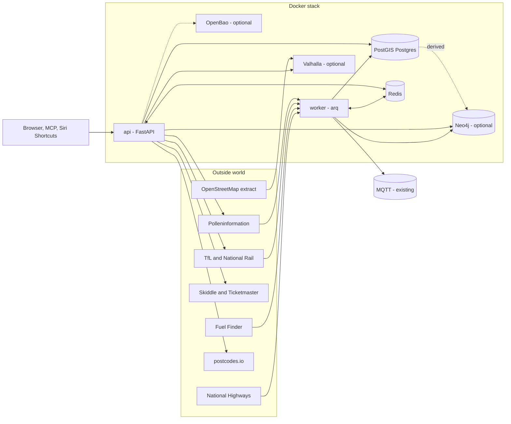

# Architecture



## Components

| Component | Role |
|-----------|------|
| `api` | FastAPI. Serves the pages and `/v1/*`, the assistant tools (`/v1/ask`, `/mcp`) and the status, backup and automatic-update endpoints. Reads the database; calls Valhalla, postcodes.io (only for a postcode the local table lacks) and (cached) the event, train and pollen services on demand. |
| `worker` | arq scheduler. Polls the feeds that are stored (National Highways, Fuel Finder, the bus tracker, pollen history) and writes to the database. The only thing that calls National Highways and Fuel Finder. Records a heartbeat the status page shows. |
| `migrate` | One-shot Alembic job that runs before the api and worker start. |
| `wa-db` | PostGIS Postgres, private to the stack. Tables holding coordinates carry a generated `geog` point and a GiST index, so radius searches are indexed ([ADR 0007](adr/0007-postgis.md)). |
| `wa-redis` | Redis, private to the stack and password protected (`redis_password`). Used for the shared upstream rate limiter, short caches and the worker heartbeat. Nothing is saved to disk. Keys are prefixed `wa:`. |
| `wa-graph` | Optional Neo4j (separate compose file) holding relationships derived from Postgres. Owns no data: the `graph_build` job rebuilds it, and it is left out of the backup on purpose. See [graph.md](graph.md). |
| `valhalla` | Optional routing engine (separate compose file). Only reachable inside the stack. |
| `openbao` | Optional key vault run beside the app (separate compose file), with an optional auto-unseal helper. See [openbao.md](openbao.md). |
| MQTT | An existing broker you provide. The worker publishes bus-tracker summaries and the fuel, train, road and pollen sensors (with a pollen map image) to it with Home Assistant discovery, so sensors appear without YAML. Events are fetched by Home Assistant itself for where each person is (the mobile app's location when away, else its home zone) (see [home-assistant.md](home-assistant.md)). |

Outside the containers, on the server: `scripts/deploy.sh` (back up, update, check), and the optional
nightly `scripts/auto-deploy.sh` ([runbook](runbook.md)). The api cannot restart containers; the
automatic-update switch on `/status` is only a stored flag that the nightly job reads.

## Code layout

```
app/
  main.py, config.py, auth.py, jobs.py, ratelimit.py, version.py    core
  secretstore.py, secretsctl.py                                     where every secret comes from
  status.py, backups.py, backup.py, autodeploy.py                   status page, backups, update switch
  places.py, trips (in places.py), vehicles.py, routing.py, geo.py places, trips, vehicles, Valhalla
  stops.py, floods.py, postcodes.py, bods.py                                              stops near a point (NaPTAN); flood warnings
  fuel.py, events.py, pollen.py, pollen_history.py, pollen_grid.py, pollen_map.py                  fuel, events and pollen (API and pages)
  bus.py, bus_page.py, tfl.py                                       bus tracker, train boards
  assistant.py                                                      /v1/ask and /mcp tools
  mqtt.py, ha.py, ha_publish.py, worker.py, smoke.py, pagestyle.py
  integrations/
    nationalhighways/   client, normalise, match (corridor geometry), store, poller, capture
    fuelfinder/         client, normalise, store, sync, queries, capture
    naptan/             normalise, sync (the national stop register, weekly)
    codepoint/          sync (Ordnance Survey postcodes, monthly)
    bods/               client (live bus positions, SIRI-VM; nothing stored)
    ../energy/          octopus, rates (pure), store, summary, sync, routes, ha (a self-contained domain module)
    tflroads/           normalise, sync, probe (TfL road disruptions, every 15 minutes)
    flood/              normalise, sync (Environment Agency flood warnings, every 15 minutes)
    tfl/ rail/          TfL Unified API; National Rail via the Rail Data Marketplace
    bus/                tracker config, poller, store, events, trips
    skiddle/ ticketmaster/ pollen/    event and pollen clients (each with a probe)
migrations/versions/    Alembic revisions
scripts/                deploy, backup-safe update, release gate, automatic updates, CI stack check
```

Each integration has the same shape: a `client` (HTTP, auth, paging, retries, rate limit),
a `normalise` module (pure functions from raw JSON to dataclasses), usually a `store` (SQL), and
jobs the worker schedules. Parsers are pure so they can be tested against small fixtures. Most clients
also have a `probe` you can run to see the real response (`python -m app.integrations.<name>.probe`).

## Data flow

1. **Poll.** The worker fetches a feed through the rate limiter, normalises it, and upserts.
2. **Only replace on complete data.** A feed that failed part-way never clears or replaces
   stored data. National Highways events missing from a *complete* fetch are marked cleared, not
   deleted. Fuel prices are applied only if the pull covers at least 90% of known stations.
3. **Tag.** Each National Highways event is matched to corridors (road number, then distance to
   the corridor centreline) and stored in `nh_event_corridor`.
4. **Query.** Endpoints read from Postgres. Nothing a user asks for waits on an upstream API, except
   the live services that are not stored (events, train boards, today's pollen), which are cached for
   seconds to hours and say so when the upstream is unavailable.

## Corridors, places and trips

A **place** is a name plus coordinates (from a postcode or given directly). A **trip** is two
places. **Build route** asks Valhalla for the road line, simplifies it, and stores it as the
trip's corridor with the road numbers it uses. Stored events are then re-tagged.

## Schema

| Table | Holds |
|-------|-------|
| `nh_event`, `nh_event_corridor` | Closures and speed limits; their corridor tags |
| `nh_sign`, `nh_sign_message` | Message signs; history, written only when the text changes |
| `nh_corridor` | Corridor centrelines (manual, draft or routed) |
| `postcode` | Every UK postcode with a position, from Code-Point Open, reloaded monthly ([docs/postcodes.md](postcodes.md)) |
| `energy_session` | Octopus Saving Sessions (and whether joined) ([docs/energy.md](energy.md)) |
| `energy_rate` | Unit rates for the tariff in use, by period ([docs/energy.md](energy.md)) |
| `tfl_road_disruption` | TfL road works, closures and incidents with their position, replaced each 15 minutes ([docs/tfl-roads.md](tfl-roads.md)) |
| `flood_warning`, `flood_area` | The Environment Agency's current flood warnings, and the boundary of each area they apply to, fetched once and kept ([docs/floods.md](floods.md)) |
| `naptan_stop` | Every bus stop, station and terminal in Great Britain with its position, reloaded weekly from NaPTAN ([docs/naptan.md](naptan.md)) |
| `fuel_station`, `fuel_price`, `fuel_price_change` | Stations; current prices; price-change history |
| `place`, `trip`, `vehicle` | User data; the trip row also holds route summary. `place.origin` and `trip.origin` are `home-assistant` for ones Home Assistant added (ids start `ha-`), empty for the rest |
| `tfl_board` | Saved train boards (station plus filter, and which source reads it) |
| `bus_tracker`, `bus_stop`, `bus_segment_obs`, `bus_anomaly`, `bus_target_day`, `bus_target_hit`, `bus_timetable` | The bus tracker: configuration, stop timings, anomalies and whether each day's bus made the target |
| `ha_location` | Extra places Home Assistant asked to watch for events, with a last-renewed time (they expire) |
| `pollen_grid` | Latest forecast for each point of the nationwide pollen lattice, refreshed a few points at a time, twice a day |
| `pollen_reading` | One value per place, day and allergen, kept 90 days (the `/pollen` graphs) |
| `app_setting` | Small switches set from the status page (automatic updates) and the last update result |
| `job_run` | One row per scheduled job run (kept 14 days) |
| `raw_capture` | Raw upstream responses used while developing parsers |
| `adapter_state` | Per-adapter bookkeeping |

## Design constraints worth knowing

- **Upstream limits drive the design.** National Highways allows 10 calls a minute per key, shared by
  everything, so polling is slow (10 minutes live, 2 hours planned) and rate-limited in Redis.
- **No PostGIS in the logic.** Corridor matching is plain Python so it can be tested without a
  spatial database. The PostGIS image is there for future queries.
- **One writer per feed.** Only the worker writes feed data; the api is read-mostly.
- **Releases are immutable and the server follows them.** The image is built once by CI, signed, and
  deployed by digest; the optional nightly job on the server verifies the signature before it installs
  anything ([ADR 0004](adr/0004-immutable-releases.md), [runbook](runbook.md)).
- **Four layers of checks.** Unit tests, then a CI job that starts the whole stack on PostGIS and requests
  every page and endpoint, then the same check after every deploy, then automatic rollback when an
  unattended update fails it.
